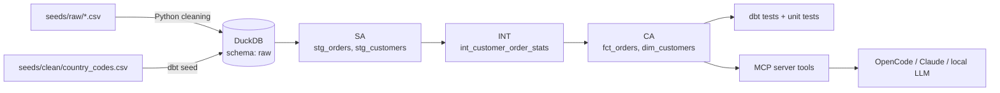

# MCP + dbt + DuckDB Practice Lab — Step-by-Step Guide

This is a **hands-on workbook**. Follow the steps in order; each step ends with a command you can run to prove it worked. Every file you need is pasted into this document, so you can build the whole lab by copy/paste.

> **Naming note:** you asked for `SA`, `INT`, `CA` layers. This guide uses:
>
> | Your name | Folder | Prefix | Common industry name | Purpose |
> |---|---|---|---|---|
> | SA | `models/sa/` | `stg_` | Staging | 1:1 with source, light cleaning/renaming, no business logic |
> | INT | `models/int/` | `int_` | Intermediate | Reusable business logic (filters, joins, aggregations) |
> | CA | `models/ca/` | `dim_` / `fct_` | Curated Analytics / Marts | Business-ready tables for BI and LLMs |
>
> If your team uses different words, only the folder names change — the pattern stays the same.

---

## Table of contents

1. [What you will build](#1-what-you-will-build)
2. [Prerequisites](#2-prerequisites)
3. [Bootstrap the project](#3-bootstrap-the-project)
4. [DuckDB: what it is and why it is everywhere now](#4-duckdb-what-it-is-and-why-it-is-everywhere-now)
5. [Seed files + Python processing into DuckDB](#5-seed-files--python-processing-into-duckdb)
6. [Configure dbt (profile + project)](#6-configure-dbt-profile--project)
7. [Build the SA → INT → CA models](#7-build-the-sa--int--ca-models)
8. [Testing: data tests vs unit tests](#8-testing-data-tests-vs-unit-tests)
9. [Build your own MCP server](#9-build-your-own-mcp-server)
10. [Free LLM APIs and local models](#10-free-llm-apis-and-local-models)
11. [Set up pre-commit](#11-set-up-pre-commit)
12. [GitHub Actions CI/CD checks](#12-github-actions-cicd-checks)
13. [Daily workflow checklist](#13-daily-workflow-checklist)
14. [Troubleshooting](#14-troubleshooting)
15. [Cheat sheet and further reading](#15-cheat-sheet-and-further-reading)

---

## 1. What you will build



Final folder layout:

```text
mcp-dbt-lab/
├── .github/workflows/ci.yml
├── .pre-commit-config.yaml
├── .env.example
├── .gitignore
├── .python-version
├── pyproject.toml
├── uv.lock
├── profiles.yml
├── dbt_project.yml
├── duckdb/                     # local .duckdb files, gitignored
├── seeds/
│   ├── raw/
│   │   ├── orders.csv          # messy input, processed by Python
│   │   └── customers.csv
│   └── clean/
│       └── country_codes.csv   # clean lookup, loaded by `dbt seed`
├── models/
│   ├── sa/
│   │   ├── schema.yml          # sources + column tests
│   │   ├── stg_orders.sql
│   │   └── stg_customers.sql
│   ├── int/
│   │   ├── schema.yml          # unit tests live here
│   │   └── int_customer_order_stats.sql
│   └── ca/
│       ├── schema.yml
│       ├── fct_orders.sql
│       └── dim_customers.sql
├── macros/
│   └── cents_to_dollars.sql
├── tests/
│   └── assert_positive_order_amounts.sql
├── scripts/
│   ├── process_seeds.py
│   ├── test_process_seeds.py
│   └── llm_smoke_test.py       # optional
└── mcp_server/
    └── server.py
```

---

## 2. Prerequisites

```bash
# macOS (Homebrew)
brew install git uv duckdb

# Or install uv directly
curl -LsSf https://astral.sh/uv/install.sh | sh

# Verify
python3 --version     # 3.12 or 3.13
uv --version
duckdb --version
git --version
gh --version          # GitHub CLI, needed only for step 12
gh auth login         # one-time GitHub login
```

If you use OpenCode as the MCP client (recommended here), install it and check:

```bash
opencode --version
```

✅ **Checkpoint:** every command above prints a version number.

---

## 3. Bootstrap the project

### 3.1 Create folders and a Python project

```bash
mkdir -p mcp-dbt-lab/{duckdb,models/{sa,int,ca},seeds/{raw,clean},tests,macros,scripts,mcp_server,.github/workflows}
cd mcp-dbt-lab

uv init --bare --python 3.13   # 3.12 works too
uv add "dbt-core<1.12" "dbt-duckdb<1.12" duckdb pytest pre-commit ruff "mcp>=2" openai python-dotenv
```

`uv` creates `.venv/`, `pyproject.toml`, and `uv.lock`. **Commit `uv.lock`** — CI uses it for reproducible installs.

> **Why pin dbt to `<1.12`?** dbt-core 1.12.x depends on `dbt-core-experimental-parser`, whose installer downloads a wheel from GitHub at **build time** using Python's `urlopen`. On macOS with a python.org Python that has no CA bundle, this fails with
> `SSL: CERTIFICATE_VERIFY_FAILED ... unable to get local issuer certificate`.
> Pinning to dbt-core 1.11 / dbt-duckdb 1.11 avoids that build completely (unit tests and everything in this lab work in 1.11).
>
> If you specifically want dbt 1.12, fix the certificates first:
>
> ```bash
> uv add certifi
> export SSL_CERT_FILE="$(.venv/bin/python -c 'import certifi; print(certifi.where())')"
> uv add "dbt-duckdb>=1.9,<2" duckdb pytest pre-commit ruff "mcp>=2" openai python-dotenv
> ```

### 3.2 Add `.python-version`

```text
3.13
```

### 3.3 Add `.gitignore`

```gitignore
__pycache__/
*.py[cod]
.venv/
.env
duckdb/*.duckdb
duckdb/*.duckdb.wal
target/
dbt_packages/
logs/
.pytest_cache/
.ruff_cache/
.DS_Store
```

### 3.4 Add `.env.example` (copy to `.env` for local work)

```env
# Same variable is used by Python, dbt and the MCP server
DBT_DUCKDB_PATH=duckdb/lab.duckdb

# Optional LLM credentials (never commit real values)
# OPENROUTER_API_KEY=
# GROQ_API_KEY=
# OLLAMA_HOST=http://127.0.0.1:11434
```

```bash
cp .env.example .env
```

> dbt v1.12+ reads `.env` automatically. With older dbt, export it in your shell:
> `set -a; source .env; set +a`.

✅ **Checkpoint:** `ls -a` shows `.venv`, `pyproject.toml`, `uv.lock`, `.env`.

---

## 4. DuckDB: what it is and why it is everywhere now

### 4.1 The 60-second explanation

**DuckDB is an embedded analytical SQL database.** Think of it as "SQLite for analytics":

| | SQLite | DuckDB |
|---|---|---|
| Storage model | Row-oriented | **Column-oriented** |
| Optimized for | Transactions, single-row lookups | **Scans, aggregations, joins** |
| Deployment | Embedded in your process | Embedded in your process |
| Reading Parquet/CSV | Possible but not native | **Native, first-class** |
| Typical use | App database | Analytics, data engineering, data science |

It runs **inside your Python process** — no server, no docker, no credentials. You point it at a `.duckdb` file, or even directly at CSV/Parquet files:

```python
import duckdb

duckdb.sql("select count(*) from read_csv_auto('seeds/raw/orders.csv')")
duckdb.sql("select * from 'data/*.parquet' limit 5")
```

### 4.2 Why you see it everywhere now

1. **Zero infrastructure.** `pip install duckdb` and you have an OLAP database. Perfect for labs, notebooks, tests, and CI.
2. **It reads the lake directly.** `read_parquet()`, `read_csv_auto()`, `read_json()`, S3/HTTP via `httpfs`. No ETL step just to inspect data.
3. **Fast.** Vectorized execution + columnar storage means aggregations over millions of rows feel instant on a laptop.
4. **Interoperable.** It speaks Arrow and pandas: `duckdb.query("...").df()` gives a DataFrame; pandas DataFrames can be queried as tables.
5. **Local-first / privacy.** Data stays on your machine — important when experimenting with LLM agents.
6. **Great fit for dbt.** `dbt-duckdb` lets you learn *all* dbt concepts (models, refs, tests, unit tests, docs) without a cloud warehouse bill.
7. **Cloud when you need it.** MotherDuck gives you a hosted DuckDB-compatible service, so the same SQL scales later.
8. **AI tooling default.** Many agent/MCP examples use DuckDB as the small, deterministic "memory" next to an LLM.

### 4.3 When *not* to use it

- Many concurrent writers from different processes (single-writer file lock).
- A production service needing network access, users, roles, and high availability.
- Multi-terabyte workloads that need a distributed engine.

For this lab it is ideal.

✅ **Checkpoint:** run this from the project root:

```bash
uv run python -c "import duckdb; print(duckdb.sql(\"select 42 as answer\").fetchall())"
# [(42,)]
```

---

## 5. Seed files + Python processing into DuckDB

**Design decision:** `seeds/raw/` holds messy input that **Python** cleans and loads into DuckDB schema `raw`. `seeds/clean/` holds a small lookup table that **dbt seed** loads. This teaches both patterns. `dbt_project.yml` points `seed-paths` only at `seeds/clean`, so dbt never tries to seed the messy files.

### 5.1 Create the raw CSVs

`seeds/raw/orders.csv` — deliberately messy (spaces, `$`, a duplicate row):

```csv
order_id,customer_id,order_date,amount,status
1,10,2026-01-01,"$120.50",completed
2,10,2026-01-02,"$40.00",CANCELLED
3,11,2026-01-03,"$75.25",completed
4,12,2026-01-04,"$10.00", pending
5,11,2026-01-05,"$25.00",refunded
5,11,2026-01-05,"$25.00",refunded
```

`seeds/raw/customers.csv`:

```csv
customer_id,name,country_code,signup_date
10,Alice Smith,us,2025-12-01
11,Bob Jones,gb,2025-12-05
12,Carla Ruiz,de,2026-01-01
```

`seeds/clean/country_codes.csv`:

```csv
country_code,country_name
US,United States
GB,United Kingdom
DE,Germany
```

### 5.2 `scripts/process_seeds.py`

```python
"""Clean the messy CSVs in seeds/raw and load them into DuckDB (schema: raw)."""

from __future__ import annotations

import os
from pathlib import Path

import duckdb
from dotenv import load_dotenv

load_dotenv()

ROOT = Path(__file__).resolve().parents[1]
RAW_DIR = ROOT / "seeds" / "raw"
DB_PATH = Path(os.getenv("DBT_DUCKDB_PATH", ROOT / "duckdb" / "lab.duckdb"))


def _csv(path: Path) -> str:
    """Return a safely quoted path for use inside a DuckDB SQL string."""
    return path.as_posix().replace("'", "''")


def main() -> None:
    DB_PATH.parent.mkdir(parents=True, exist_ok=True)
    con = duckdb.connect(str(DB_PATH))
    try:
        con.execute("CREATE SCHEMA IF NOT EXISTS raw")

        con.execute(f"""
            CREATE OR REPLACE TABLE raw.orders AS
            SELECT DISTINCT
                CAST(trim(order_id) AS BIGINT)     AS order_id,
                CAST(trim(customer_id) AS BIGINT)  AS customer_id,
                CAST(trim(order_date) AS DATE)     AS order_date,
                CAST(
                    replace(replace(trim(amount), '$', ''), ',', '') AS DECIMAL(12, 2)
                )                                  AS amount_usd,
                lower(trim(status))                AS status
            FROM read_csv_auto('{_csv(RAW_DIR / "orders.csv")}',
                               header = true, all_varchar = true)
            WHERE trim(order_id) <> '' AND trim(customer_id) <> ''
        """)

        con.execute(f"""
            CREATE OR REPLACE TABLE raw.customers AS
            SELECT DISTINCT
                CAST(trim(customer_id) AS BIGINT) AS customer_id,
                trim(name)                        AS customer_name,
                upper(trim(country_code))         AS country_code,
                CAST(trim(signup_date) AS DATE)   AS signup_date
            FROM read_csv_auto('{_csv(RAW_DIR / "customers.csv")}',
                               header = true, all_varchar = true)
            WHERE trim(customer_id) <> ''
        """)

        for table in ("orders", "customers"):
            count = con.execute(f"select count(*) from raw.{table}").fetchone()[0]
            print(f"raw.{table}: {count} rows")
    finally:
        con.close()


if __name__ == "__main__":
    main()
```

Run it:

```bash
uv run python scripts/process_seeds.py
# raw.orders: 5 rows
# raw.customers: 3 rows
```

Verify with DuckDB CLI:

```bash
duckdb duckdb/lab.duckdb -c "select * from raw.orders order by order_id;"
duckdb duckdb/lab.duckdb -c "show all tables;"
```

### 5.3 A Python test for the loader

`scripts/test_process_seeds.py`:

```python
from __future__ import annotations

import duckdb

import process_seeds


def test_process_seeds_creates_clean_tables(tmp_path, monkeypatch) -> None:
    raw = tmp_path / "raw"
    raw.mkdir()
    (raw / "orders.csv").write_text(
        "order_id,customer_id,order_date,amount,status\n"
        '1,10,2026-01-01,"$10.50", COMPLETED \n'
        '1,10,2026-01-01,"$10.50", COMPLETED \n'
    )
    (raw / "customers.csv").write_text(
        "customer_id,name,country_code,signup_date\n"
        "10, Alice ,us,2025-12-01\n"
    )
    db = tmp_path / "test.duckdb"

    monkeypatch.setattr(process_seeds, "RAW_DIR", raw)
    monkeypatch.setattr(process_seeds, "DB_PATH", db)
    process_seeds.main()

    con = duckdb.connect(str(db), read_only=True)
    try:
        assert con.execute(
            "select order_id, amount_usd, status from raw.orders"
        ).fetchall() == [(1, 10.50, "completed")]
        assert con.execute(
            "select country_code from raw.customers"
        ).fetchall() == [("US",)]
    finally:
        con.close()
```

```bash
uv run pytest -q
# 1 passed
```

> This is a genuine unit test of your Python ingestion logic: it uses a temporary database and tiny fixtures, so it is fast and deterministic in CI.

✅ **Checkpoint:** the script prints `raw.orders: 5 rows` and pytest passes.

---

## 6. Configure dbt (profile + project)

### 6.1 `profiles.yml` at the project root

```yaml
mcp_dbt_lab:
  target: dev
  outputs:
    dev:
      type: duckdb
      path: "{{ env_var('DBT_DUCKDB_PATH', 'duckdb/lab.duckdb') }}"
      schema: main
      threads: 4
```

The `database` is derived from the file name (`lab`), and `schema: main` is where dbt builds models. `raw` is our Python-owned source schema.

### 6.2 `dbt_project.yml`

```yaml
name: mcp_dbt_lab
version: "1.0.0"
config-version: 2
profile: mcp_dbt_lab

model-paths: ["models"]
seed-paths: ["seeds/clean"]      # only clean lookup data is dbt-managed
test-paths: ["tests"]
macro-paths: ["macros"]

target-path: "target"
clean-targets: ["target", "dbt_packages"]

models:
  mcp_dbt_lab:
    sa:
      +materialized: view        # cheap, transparent staging
      +tags: ["staging"]
    int:
      +materialized: view
      +tags: ["intermediate"]
    ca:
      +materialized: table       # fast reads for BI / MCP tools
      +tags: ["marts"]

seeds:
  mcp_dbt_lab:
    country_codes:
      +materialized: seed
```

### 6.3 Verify the connection

```bash
DBT_PROFILES_DIR=. uv run dbt debug
```

Look for `Connection test: OK connection ok`.

### 6.4 Load the dbt seed

```bash
DBT_PROFILES_DIR=. uv run dbt seed --select country_codes
```

Since we set `DBT_PROFILES_DIR` a lot, add it to your shell once:

```bash
echo 'export DBT_PROFILES_DIR="$PWD"' >> ~/.zshrc   # or use .env / direnv
```

✅ **Checkpoint:** `duckdb duckdb/lab.duckdb -c "select * from main.country_codes;"` returns 3 rows.

---

## 7. Build the SA → INT → CA models

### 7.1 `models/sa/schema.yml` — sources + tests

```yaml
version: 2

sources:
  - name: raw
    description: Tables produced by scripts/process_seeds.py from seeds/raw/*.csv
    schema: raw
    tables:
      - name: orders
        description: One cleaned order per row, loaded by Python.
      - name: customers
        description: One cleaned customer per row, loaded by Python.

models:
  - name: stg_orders
    description: SA layer — one order per row, cents added, no business logic yet.
    columns:
      - name: order_id
        description: Primary key.
        tests: [unique, not_null]
      - name: customer_id
        tests: [not_null]
      - name: status
        tests:
          - accepted_values:
              values: [completed, cancelled, pending, refunded]

  - name: stg_customers
    description: SA layer — one customer per row, country code normalized to uppercase.
    columns:
      - name: customer_id
        tests: [unique, not_null]
      - name: country_code
        tests: [not_null]
```

### 7.2 `models/sa/stg_orders.sql`

```sql
with source as (
    select * from {{ source('raw', 'orders') }}
),

renamed as (
    select
        order_id,
        customer_id,
        order_date,
        cast(amount_usd * 100 as bigint) as amount_cents,
        status
    from source
)

select * from renamed
```

### 7.3 `models/sa/stg_customers.sql`

```sql
with source as (
    select * from {{ source('raw', 'customers') }}
),

renamed as (
    select
        customer_id,
        customer_name,
        country_code,
        signup_date
    from source
)

select * from renamed
```

### 7.4 `macros/cents_to_dollars.sql`

```sql

    cast({{ column_name }} as decimal(14, 2)) / 100

```

### 7.5 `models/int/int_customer_order_stats.sql`

```sql
with orders as (
    select * from {{ ref('stg_orders') }}
),

completed as (
    select *
    from orders
    where status = 'completed'
),

per_customer as (
    select
        customer_id,
        count(*)                  as completed_order_count,
        sum(amount_cents)         as lifetime_amount_cents,
        min(order_date)           as first_completed_order_date,
        max(order_date)           as last_completed_order_date
    from completed
    group by 1
)

select * from per_customer
```

### 7.6 `models/int/schema.yml` — unit test for the INT logic

```yaml
version: 2

models:
  - name: int_customer_order_stats
    description: INT layer — reusable per-customer statistics over completed orders only.
    columns:
      - name: customer_id
        tests: [unique, not_null]

unit_tests:
  - name: test_only_completed_orders_are_counted
    description: Cancelled and pending orders must not affect customer stats.
    model: int_customer_order_stats
    given:
      - input: ref('stg_orders')
        rows:
          - {order_id: 1, customer_id: 10, order_date: 2026-01-01, amount_cents: 10000, status: completed}
          - {order_id: 2, customer_id: 10, order_date: 2026-01-02, amount_cents:  4000, status: cancelled}
          - {order_id: 3, customer_id: 11, order_date: 2026-01-03, amount_cents:  7500, status: pending}
    expect:
      rows:
        - {customer_id: 10, completed_order_count: 1, lifetime_amount_cents: 10000, first_completed_order_date: 2026-01-01, last_completed_order_date: 2026-01-01}
```

> **Rule:** include every `ref`/`source` used by the model as an `input`, otherwise dbt reports "node not found". Unit tests must be defined in YAML under `models/`, not in `tests/`.

### 7.7 `models/ca/fct_orders.sql`

```sql
select
    order_id,
    customer_id,
    order_date,
    status,
    {{ cents_to_dollars('amount_cents') }} as amount_usd
from {{ ref('stg_orders') }}
```

### 7.8 `models/ca/dim_customers.sql`

```sql
with customers as (
    select * from {{ ref('stg_customers') }}
),

stats as (
    select * from {{ ref('int_customer_order_stats') }}
),

countries as (
    select * from {{ ref('country_codes') }}
),

final as (
    select
        c.customer_id,
        c.customer_name,
        c.signup_date,
        co.country_name,
        coalesce(s.completed_order_count, 0)      as completed_order_count,
        {{ cents_to_dollars('coalesce(s.lifetime_amount_cents, 0)') }}
                                                  as lifetime_amount_usd
    from customers c
    left join stats s on c.customer_id = s.customer_id
    left join countries co on c.country_code = co.country_code
)

select * from final
```

### 7.9 `models/ca/schema.yml`

```yaml
version: 2

models:
  - name: fct_orders
    description: CA layer — one order per row with amounts in dollars.
    columns:
      - name: order_id
        tests: [unique, not_null]
      - name: customer_id
        tests:
          - not_null
          - relationships:
              to: ref('dim_customers')
              field: customer_id
      - name: amount_usd
        tests: [not_null]

  - name: dim_customers
    description: CA layer — one row per customer with country and lifetime stats.
    columns:
      - name: customer_id
        tests: [unique, not_null]
      - name: completed_order_count
        tests: [not_null]
```

### 7.10 `tests/assert_positive_order_amounts.sql` (singular data test)

```sql
-- Fails if any order amount is zero or negative
select order_id, amount_usd
from {{ ref('fct_orders') }}
where amount_usd <= 0
```

### 7.11 Run the whole DAG

```bash
DBT_PROFILES_DIR=. uv run dbt build
```

`dbt build` runs, in lineage order: unit tests → models → data tests. Expected: `PASS=... ERROR=0`.

Inspect the result:

```bash
duckdb duckdb/lab.duckdb -c "select * from main.dim_customers order by customer_id;"
duckdb duckdb/lab.duckdb -c "select * from main.fct_orders order by order_id;"
DBT_PROFILES_DIR=. uv run dbt docs generate   # creates target/catalog.json
```

✅ **Checkpoint:** `dim_customers` shows Alice with `completed_order_count = 1` and `lifetime_amount_usd = 120.5`; Bob and Carla show `0`.

---

## 8. Testing: data tests vs unit tests

| | Data tests | Unit tests |
|---|---|---|
| Question answered | "Is the **data** correct?" | "Is the **SQL logic** correct?" |
| Input | Real relations in the warehouse | Static fixture rows you write in YAML |
| Runs | After the model is built | Before the model is materialized (in `dbt build`) |
| Examples | `unique`, `not_null`, `accepted_values`, `relationships`, singular SQL test | "cancelled orders are excluded", "tax = 8% of subtotal" |
| Best for | Keys, enums, referential integrity, invariants | CASE branches, joins, date math, window functions |

Useful commands:

```bash
# Only unit tests
DBT_PROFILES_DIR=. uv run dbt test --select test_type:unit

# Only data tests
DBT_PROFILES_DIR=. uv run dbt test --select test_type:data

# Everything for one model (upstream + downstream)
DBT_PROFILES_DIR=. uv run dbt build --select +fct_orders+

# Parse only — catches YAML/Jinja errors fast, no database needed
DBT_PROFILES_DIR=. uv run dbt parse
```

**What to test in a real project:** primary keys (`unique` + `not_null`), foreign keys (`relationships`), allowed enums, non-negative amounts, freshness on sources, and unit tests on any model with a `case when`, a join that filters, or date math.

> In production you can exclude unit tests with `--exclude-resource-type unit_test`; in CI you want them.

✅ **Checkpoint:** the unit-test command reports `PASS=1`, and `dbt parse` finishes in a couple of seconds.

---

## 9. Build your own MCP server

### 9.1 What MCP is

MCP (Model Context Protocol) is a standard way for an LLM client to talk to a small program that exposes:

- **Tools** — functions the model can call (e.g. `query_duckdb`).
- **Resources** — file-like data the model can read (e.g. a manifest summary).
- **Prompts** — reusable prompt templates.

Our server uses **stdio transport**: the client starts it as a subprocess and speaks JSON-RPC over stdin/stdout.

> ⚠️ **Critical rule for stdio servers:** never call `print()` — stdout is the protocol channel. Log to stderr with `logging`.

### 9.2 `mcp_server/server.py`

```python
"""Tiny MCP server exposing the local dbt + DuckDB lab to an LLM client.

Stdio transport: logs go to stderr only.
"""

from __future__ import annotations

import logging
import os
import re
import subprocess
import sys
from pathlib import Path

import duckdb
from dotenv import load_dotenv
from mcp.server import MCPServer
from mcp.server.mcpserver.exceptions import ToolError

load_dotenv()

logging.basicConfig(level=logging.INFO, stream=sys.stderr)
logger = logging.getLogger(__name__)

ROOT = Path(__file__).resolve().parents[1]
DB_PATH = Path(os.getenv("DBT_DUCKDB_PATH", ROOT / "duckdb" / "lab.duckdb"))
SAFE_DBT_COMMANDS = {"parse", "seed", "run", "test", "build", "docs"}

mcp = MCPServer("dbt-duckdb-lab")


def _connect() -> duckdb.DuckDBPyConnection:
    if not DB_PATH.exists():
        raise ToolError(
            f"Database not found: {DB_PATH}. "
            "Run: uv run python scripts/process_seeds.py"
        )
    return duckdb.connect(str(DB_PATH), read_only=True)


@mcp.tool()
def query_duckdb(sql: str, limit: int = 50) -> str:
    """Run a read-only SELECT against the local DuckDB file and return rows as text.

    Args:
        sql: A SELECT / WITH / SHOW / DESCRIBE query. No writes or DDL allowed.
        limit: Maximum rows to return (default 50, capped at 200).
    """
    cleaned = sql.strip().rstrip(";")
    if not re.match(r"^(select|with|show|describe|pragma)\b", cleaned, re.IGNORECASE):
        raise ToolError("Only read-only queries are allowed.")
    limit = max(1, min(int(limit), 200))

    con = _connect()
    try:
        result = con.execute(cleaned)
        columns = [d[0] for d in result.description]
        rows = result.fetchmany(limit)
    finally:
        con.close()

    header = " | ".join(columns)
    body = "\n".join(" | ".join(str(v) for v in row) for row in rows)
    return f"{header}\n{body}" if body else f"{header}\n(no rows)"


@mcp.tool()
def list_dbt_models() -> str:
    """List dbt models grouped by SA, INT and CA layer."""
    lines = []
    for layer in ("sa", "int", "ca"):
        files = sorted((ROOT / "models" / layer).glob("*.sql"))
        lines.append(f"[{layer}] " + (", ".join(f.stem for f in files) or "(none)"))
    return "\n".join(lines)


@mcp.tool()
def get_model_sql(model_name: str) -> str:
    """Return the SQL source of a dbt model.

    Args:
        model_name: Model file name without .sql, e.g. stg_orders.
    """
    if not re.fullmatch(r"[A-Za-z0-9_]+", model_name):
        raise ToolError("Invalid model name.")
    matches = list((ROOT / "models").glob(f"**/{model_name}.sql"))
    if not matches:
        raise ToolError(f"Model not found: {model_name}")
    return matches[0].read_text()


@mcp.tool()
def run_dbt(command: str = "build") -> str:
    """Run a whitelisted dbt command in the project root and return its output.

    Args:
        command: One of parse, seed, run, test, build, docs. No extra flags.
    """
    if command not in SAFE_DBT_COMMANDS:
        raise ToolError(f"Command not allowed. Choose from: {sorted(SAFE_DBT_COMMANDS)}")

    env = {**os.environ, "DBT_PROFILES_DIR": str(ROOT)}
    result = subprocess.run(
        ["uv", "run", "dbt", command],
        cwd=ROOT,
        env=env,
        capture_output=True,
        text=True,
        timeout=600,
    )
    output = (result.stdout + result.stderr).strip()
    if result.returncode != 0:
        raise ToolError(f"dbt {command} failed (exit {result.returncode}):\n{output[-4000:]}")
    return output[-4000:] or f"dbt {command} completed."


if __name__ == "__main__":
    mcp.run(transport="stdio")
```

**Security habits demonstrated here:** read-only DuckDB connection, SQL prefix whitelist, dbt command whitelist, no shell (`subprocess.run` with a list), model-name regex, and no secrets in code.

### 9.3 Test the server directly with the MCP Inspector

```bash
# List tools using the modern protocol revision
npx @modelcontextprotocol/inspector --cli \
  uv run mcp_server/server.py \
  --protocol-era modern --method tools/list

# And with the legacy handshake
npx @modelcontextprotocol/inspector --cli \
  uv run mcp_server/server.py \
  --protocol-era legacy --method tools/list
```

You should see `query_duckdb`, `list_dbt_models`, `get_model_sql`, `run_dbt`.

### 9.4 Register it in OpenCode

OpenCode V2 keeps servers under `mcp.servers` (not directly under `mcp`). Project config: `.opencode/opencode.jsonc`; global config: `~/.config/opencode/opencode.jsonc`.

Get your absolute path first: `pwd`.

```jsonc
{
  "$schema": "https://opencode.ai/config.json",
  "mcp": {
    "servers": {
      "dblab": {
        "type": "local",
        "command": [
          "uv", "run", "--directory", "/ABSOLUTE/PATH/TO/mcp-dbt-lab",
          "python", "mcp_server/server.py"
        ],
        "cwd": "/ABSOLUTE/PATH/TO/mcp-dbt-lab",
        "protocol": "auto",
        "environment": {
          "DBT_DUCKDB_PATH": "/ABSOLUTE/PATH/TO/mcp-dbt-lab/duckdb/lab.duckdb"
        }
      }
    }
  }
}
```

Equivalent CLI (then add `"protocol": "auto"` by hand in the config):

```bash
opencode mcp add dblab --env DBT_DUCKDB_PATH="$PWD/duckdb/lab.duckdb" -- \
  uv run --directory "$PWD" python mcp_server/server.py
opencode mcp list
```

Then in OpenCode:

- `/mcps` → check `dblab` shows **connected**.
- Ask: *"Use the dblab tools to list the dbt models and show me the top 3 orders."*
- With Code Mode (the default), tools appear as `tools.dblab.query_duckdb(...)`; tool names follow `<server>_<tool>`.

Config changes reload automatically; use `/reload` to force a full reload. No restart needed.

### 9.5 Alternative: Claude Desktop

`~/Library/Application Support/Claude/claude_desktop_config.json`:

```json
{
  "mcpServers": {
    "dblab": {
      "command": "uv",
      "args": [
        "--directory", "/ABSOLUTE/PATH/TO/mcp-dbt-lab",
        "run", "python", "mcp_server/server.py"
      ],
      "env": {
        "DBT_DUCKDB_PATH": "/ABSOLUTE/PATH/TO/mcp-dbt-lab/duckdb/lab.duckdb"
      }
    }
  }
}
```

✅ **Checkpoint:** `opencode mcp list` (or Inspector) shows 4 tools, and calling `query_duckdb` with `select count(*) from main.fct_orders` returns `5`.

---

## 10. Free LLM APIs and local models

You have three good options. Start with **Ollama** (fully local, free, private), then try a free API if you want stronger reasoning/tool use.

### Option A — Ollama, fully local

```bash
brew install ollama
ollama serve                 # terminal 1: leave running
ollama pull qwen3:8b         # terminal 2 (good tool use); low RAM? use qwen3:4b or llama3.2:3b
ollama list
```

OpenCode discovers a local Ollama server automatically — no config needed. Start `opencode`, run `/models`, and select something like `ollama/qwen3:8b`.

Custom/remote Ollama endpoint (optional):

```jsonc
{
  "$schema": "https://opencode.ai/config.json",
  "providers": {
    "ollama": {
      "settings": { "baseURL": "https://ollama.example.com/v1" }
    }
  }
}
```

Include `/v1` — OpenCode derives `/api/tags` and `/api/show` from it.

### Option B — OpenRouter free models

```bash
export OPENROUTER_API_KEY="sk-or-..."   # put it in ~/.zshrc, never in git
```

OpenRouter is a built-in provider in OpenCode. Run `/models` and choose an OpenRouter model with a `:free` suffix (free tier has rate limits — check <https://openrouter.ai/models?free=true> for what is currently free).

```jsonc
{
  "$schema": "https://opencode.ai/config.json",
  "model": "openrouter/anthropic/claude-sonnet-5.5"
}
```

Replace the model ID with a currently available free one from the catalog.

### Option C — Groq free tier via a custom OpenAI-compatible provider

Get a key at <https://console.groq.com>, then:

```jsonc
{
  "$schema": "https://opencode.ai/config.json",
  "model": "groq/fast",
  "providers": {
    "groq": {
      "name": "Groq",
      "env": ["GROQ_API_KEY"],
      "package": "@opencode/ai/providers/openai-compatible",
      "settings": { "baseURL": "https://api.groq.com/openai/v1" },
      "models": {
        "fast": {
          "modelID": "llama-3.1-8b-instant",
          "name": "Groq Llama 3.1 8B Instant"
        }
      }
    }
  }
}
```

Model IDs change — copy a current one from your Groq console. `env` names are resolved from the OpenCode server process environment.

### Optional smoke test script

`scripts/llm_smoke_test.py` — one prompt, any OpenAI-compatible endpoint:

```python
"""One prompt against Ollama, Groq, or any OpenAI-compatible endpoint."""

import os

from openai import OpenAI

client = OpenAI(
    base_url=os.getenv("LLM_BASE_URL", "http://127.0.0.1:11434/v1"),
    api_key=os.getenv("LLM_API_KEY", "ollama"),
)
response = client.chat.completions.create(
    model=os.getenv("LLM_MODEL", "qwen3:8b"),
    messages=[{"role": "user", "content": "Reply with exactly: OK"}],
)
print(response.choices[0].message.content)
```

```bash
# Local Ollama
uv run python scripts/llm_smoke_test.py

# Groq
LLM_BASE_URL=https://api.groq.com/openai/v1 \
LLM_API_KEY="$GROQ_API_KEY" \
LLM_MODEL="llama-3.1-8b-instant" \
uv run python scripts/llm_smoke_test.py
```

### How it all connects

1. Start Ollama (or export a free API key).
2. OpenCode uses that model for reasoning.
3. OpenCode calls your MCP tools (`dblab_query_duckdb`, `dblab_run_dbt`, ...).
4. Tools read the DuckDB file and run dbt locally.

Practical tip: small local models (3B) often struggle with multi-step tool use. Use 8B+ or a free API model when you want the agent to orchestrate several tools; use the small local model for cheap experiments.

✅ **Checkpoint:** the smoke test prints `OK`, and `/models` in OpenCode lists your chosen model.

---

## 11. Set up pre-commit

### 11.1 `.pre-commit-config.yaml`

```yaml
repos:
  - repo: https://github.com/pre-commit/pre-commit-hooks
    rev: v5.0.0
    hooks:
      - id: trailing-whitespace
      - id: end-of-file-fixer
      - id: check-yaml
      - id: check-json
      - id: check-added-large-files
      - id: detect-private-key

  - repo: https://github.com/astral-sh/ruff-pre-commit
    rev: v0.9.6
    hooks:
      - id: ruff
        args: [--fix]
      - id: ruff-format

  - repo: local
    hooks:
      - id: dbt-parse
        name: dbt parse (catch YAML/Jinja errors)
        entry: uv run dbt parse --quiet
        language: system
        pass_filenames: false
        files: ^(models|seeds|macros|tests|dbt_project\.yml|profiles\.yml)/
        env: [DBT_PROFILES_DIR=.]
```

> Hook versions go stale. After installing, run `pre-commit autoupdate` to pin current revisions. It rewrites the `rev:` fields for you.

### 11.2 Install and run

```bash
uv run pre-commit install          # runs on every `git commit`
uv run pre-commit run --all-files  # run now against everything
uv run pre-commit autoupdate       # refresh hook versions (do this once)
```

Typical first run: hooks auto-fix files. Re-run until clean:

```bash
uv run pre-commit run --all-files
# All hooks passed
```

If a hook modifies files, `git add` them and commit again — that is normal.

### 11.3 Optional: SQL linting

If you want SQL style checks too, add `sqlfluff` to `uv add` and a config file:

```ini
# .sqlfluff
[sqlfluff]
dialect = duckdb
templater = dbt
```

```bash
uv add sqlfluff
uv run sqlfluff lint models
```

The dbt templater needs a working profile, which is why it is optional here.

✅ **Checkpoint:** `pre-commit run --all-files` passes with zero failures.

---

## 12. GitHub Actions CI/CD checks

### 12.1 Concepts you need

| Term | Meaning |
|---|---|
| Workflow | A YAML file in `.github/workflows/` — a named automation |
| Event (`on:`) | What triggers it: `push`, `pull_request`, `workflow_dispatch` (manual) |
| Job | Independent unit of work; jobs run in parallel on separate runners |
| Step | A command (`run:`) or a reusable action (`uses:`) inside a job |
| Runner | The machine executing the job (`ubuntu-latest`) |
| Action | Reusable step from the Marketplace (`actions/checkout`, `astral-sh/setup-uv`) |
| Artifact | Files uploaded from a run (here: `target/` with manifest + catalog) |
| Secret | Encrypted value in Repo → Settings → Secrets (not needed for this lab) |
| Concurrency | Cancel superseded runs when you push again quickly |
| Status check | A job must pass before a PR can merge (configure branch protection) |

### 12.2 `.github/workflows/ci.yml`

```yaml
name: CI

on:
  push:
    branches: [main]
  pull_request:
  workflow_dispatch:

concurrency:
  group: ci-${{ github.ref }}
  cancel-in-progress: true

jobs:
  lint:
    name: Format & static checks
    runs-on: ubuntu-latest
    steps:
      - uses: actions/checkout@v4

      - name: Install uv
        uses: astral-sh/setup-uv@v9
        with:
          enable-cache: true

      - name: Install locked dependencies
        run: |
          uv python install
          uv sync --frozen

      - name: pre-commit (ruff, YAML, whitespace, dbt parse)
        run: uv run pre-commit run --all-files

  dbt:
    name: dbt parse + unit/data tests
    runs-on: ubuntu-latest
    env:
      DBT_PROFILES_DIR: ${{ github.workspace }}
      DBT_DUCKDB_PATH: ${{ github.workspace }}/duckdb/ci.duckdb
    steps:
      - uses: actions/checkout@v4

      - name: Install uv
        uses: astral-sh/setup-uv@v9
        with:
          enable-cache: true

      - name: Install locked dependencies
        run: |
          uv python install
          uv sync --frozen

      - name: Python unit tests for the seed loader
        run: uv run pytest -q

      - name: Clean raw CSVs into DuckDB
        run: uv run python scripts/process_seeds.py

      - name: dbt parse (YAML/Jinja validity)
        run: uv run dbt parse

      - name: dbt seed (lookup data)
        run: uv run dbt seed --select country_codes

      - name: dbt build (models, unit tests, data tests)
        run: uv run dbt build

      - name: Explicit unit-test check
        run: uv run dbt test --select test_type:unit

      - name: Generate docs/catalog
        run: uv run dbt docs generate

      - name: Upload dbt artifacts
        if: always()
        uses: actions/upload-artifact@v4
        with:
          name: dbt-artifacts
          path: target/
```

> Action versions move fast. If an action tag is deprecated, check the Marketplace and bump the major version. The logic of the workflow does not change.

**Why these steps matter:**

- `dbt parse` fails fast on bad YAML/Jinja before any database work.
- `pytest` catches Python ingestion regressions independently of dbt.
- `dbt build` materializes models and runs both test types in lineage order.
- `if: always()` uploads `target/` even when a step fails, so you can debug from the browser.
- `uv sync --frozen` guarantees CI uses exactly your `uv.lock`.

### 12.3 Push to GitHub

```bash
git init
git add .
git commit -m "chore: bootstrap dbt + duckdb + mcp lab"
gh repo create mcp-dbt-lab --private --source=. --remote=origin --push
# or, if the repo already exists:
# git remote add origin git@github.com:<you>/mcp-dbt-lab.git
# git push -u origin main
```

Open `https://github.com/<you>/mcp-dbt-lab/actions` and watch both jobs run.

### 12.4 Protect the main branch

Repo → Settings → Branches → Add rule for `main`:

- ✅ Require a pull request before merging
- ✅ Require status checks to pass: `Format & static checks`, `dbt parse + unit/data tests`

### 12.5 Useful extra CI ideas (after the basics work)

- `paths:` filter to skip dbt job when only docs change.
- A `matrix` over Python versions (`3.11`, `3.12`).
- `dbt build --select state:modified+` with `defer` for large projects (needs artifacts from the default branch).
- Post a PR comment with `dbt` results (upload `target/run_results.json` and parse it).
- Run `dbt source freshness` if you have real sources with timestamps.

✅ **Checkpoint:** both CI jobs are green, and `dbt-artifacts` is downloadable.

---

## 13. Daily workflow checklist

Copy this into your notes and follow it for every change:

```text
[ ] 1. Read the task; decide which layer changes (SA / INT / CA).
[ ] 2. Write or change a test FIRST (unit test for logic, data test for data quality).
[ ] 3. Edit the model SQL / seed / Python loader.
[ ] 4. uv run python scripts/process_seeds.py     (if raw data changed)
[ ] 5. uv run pytest -q
[ ] 6. DBT_PROFILES_DIR=. uv run dbt parse
[ ] 7. DBT_PROFILES_DIR=. uv run dbt build
[ ] 8. uv run pre-commit run --all-files
[ ] 9. Inspect output: duckdb duckdb/lab.duckdb -c "select * from main.dim_customers;"
[ ] 10. git add -p && git commit -m "feat: add <thing>"
[ ] 11. git push; open PR; wait for CI green; merge.
[ ] 12. (Optional) ask OpenCode via the dblab MCP tools: "what changed in fct_orders?"
```

---

## 14. Troubleshooting

| Symptom | Likely cause | Fix |
|---|---|---|
| `SSL: CERTIFICATE_VERIFY_FAILED` while building `dbt-core-experimental-parser` | dbt-core 1.12's build step downloads a wheel from GitHub via Python `urlopen`; python.org Python has no CA bundle | Pin `dbt-core<1.12` + `dbt-duckdb<1.12` (recommended), or install `certifi` and export `SSL_CERT_FILE` as shown in step 3 |
| `dbt: Compilation Error: Profile mcp_dbt_lab not found` | `DBT_PROFILES_DIR` not set | `export DBT_PROFILES_DIR=.` or put `profiles.yml` in `~/.dbt/` |
| `IO Error: Could not set lock on file ...lab.duckdb` | Another process (DuckDB CLI / MCP server) holds the file | Close other connections; MCP server opens read-only, CI uses a separate `ci.duckdb` |
| Unit test: `node not found` | Missing `given.input` for a `ref`/`source` | Add every upstream reference as an input in `unit_tests` |
| Unit test: upstream relation does not exist | Running `dbt test --select test_type:unit` before building parents | Run `dbt build` first, or `dbt run --select <parents> --empty` |
| `dbt seed` says no seeds found | Wrong `seed-paths` | Keep clean seed in `seeds/clean/` as configured |
| MCP server not connected | Wrong absolute path, or `uv` not on client PATH | Use full path from `which uv`; check `opencode mcp list`; look in `~/.local/share/opencode/log/opencode.log` |
| MCP tool fails: "Database not found" | `DBT_DUCKDB_PATH` differs between shell and client | Set the same absolute path in `.env` and in the MCP config `environment` |
| Weird MCP protocol error | Old handshake against new SDK | Set `"protocol": "auto"` on the server in OpenCode config |
| pre-commit modifies files then fails | Normal first-run auto-fix | `git add .` and re-run `pre-commit run --all-files` |
| `check-yaml` fails on workflow | Indentation/tabs in YAML | Use spaces; validate with `python -c "import yaml,sys; yaml.safe_load(open(sys.argv[1]))" .github/workflows/ci.yml` |
| OpenCode shows no Ollama models | Server not running or model has no completion capability | `ollama serve`, `ollama pull qwen3:8b`, check `curl http://127.0.0.1:11434/api/tags` |

---

## 15. Cheat sheet and further reading

### Commands

```bash
# Environment
uv sync; uv run python --version

# Data prep
uv run python scripts/process_seeds.py
uv run pytest -q
duckdb duckdb/lab.duckdb -c "select * from raw.orders;"

# dbt
DBT_PROFILES_DIR=. uv run dbt debug
DBT_PROFILES_DIR=. uv run dbt parse
DBT_PROFILES_DIR=. uv run dbt seed --select country_codes
DBT_PROFILES_DIR=. uv run dbt build
DBT_PROFILES_DIR=. uv run dbt test --select test_type:unit
DBT_PROFILES_DIR=. uv run dbt docs generate

# MCP
npx @modelcontextprotocol/inspector --cli uv run mcp_server/server.py --method tools/list
opencode mcp list

# Quality & CI
uv run pre-commit run --all-files
git status
```

### References

- DuckDB: <https://duckdb.org/docs/>
- dbt + DuckDB setup: <https://docs.getdbt.com/docs/local/connect-data-platform/duckdb-setup>
- dbt unit tests: <https://docs.getdbt.com/docs/build/unit-tests>
- dbt data tests: <https://docs.getdbt.com/docs/build/data-tests>
- MCP Python SDK: <https://modelcontextprotocol.io/docs/develop/build-server>
- OpenCode MCP config: <https://opencode.ai/docs/mcp-servers>
- OpenCode providers (Ollama, OpenRouter, custom): <https://opencode.ai/docs/providers>
- uv in GitHub Actions: <https://docs.astral.sh/uv/guides/integration/github/>
- pre-commit: <https://pre-commit.com/>

### Exercises to extend the lab

1. Add a new `stg_payments` seed/model and a `fct_revenue` model in CA; write a unit test for currency conversion.
2. Add a `snapshots/` directory and snapshot `stg_orders` to learn SCD Type 2.
3. Add `dbt_utils` in `packages.yml` (`dbt deps`) and use `dbt_utils.expression_is_true`.
4. Add a fourth MCP tool `describe_table(table_name)` using `pragma table_info`.
5. Add an MCP **resource** that exposes `target/manifest.json` as `dbt://manifest`.
6. Add a GitHub Action that posts `dbt run_results.json` as a PR comment.
7. Switch the profile to `:memory:` for a fully ephemeral CI run (only if all steps happen in one process).

---

**You are done when:** `dbt build` is green locally, `pre-commit run --all-files` passes, the MCP server lists 4 tools in OpenCode, a local or free LLM answers a question using those tools, and both GitHub Actions jobs are green on a PR.
